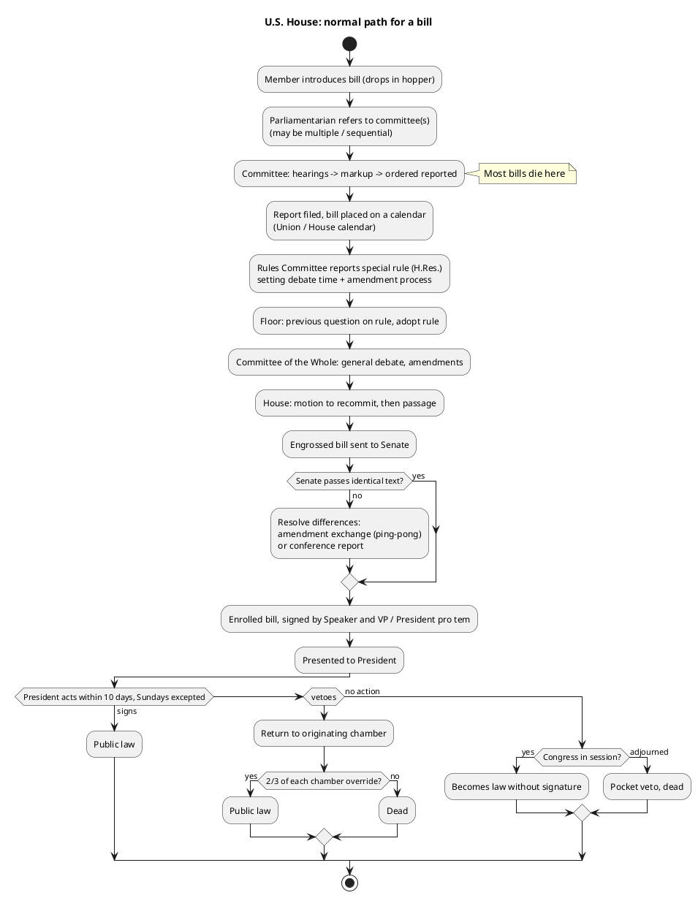

# The normal path: bill to public law

## Measure types

| Prefix | Name | Goes to President? | Used for |
| --- | --- | --- | --- |
| `H.R.` / `S.` | Bill | Yes | Almost all law, including appropriations |
| `H.J.Res.` / `S.J.Res.` | Joint resolution | Yes, except constitutional amendments | Continuing resolutions, CRA disapprovals, constitutional amendments (which go to the states), some war powers measures |
| `H.Con.Res.` / `S.Con.Res.` | Concurrent resolution | No, and not law | Budget resolution, adjournment, War Powers Act §5(c) removal directives, sense of Congress |
| `H.Res.` / `S.Res.` | Simple resolution | No, one chamber only | Special rules, House rules package, censure, expulsion, impeachment articles, contempt, committee elections, motion to vacate the chair |

Revenue bills must start in the House (Art. I §7). By custom, appropriations bills do too. The Senate
gets around this by amending a House-numbered "shell" bill with unrelated text.

## Flow

## Stages, with what to look for

1. **Introduction and referral.** Any member can introduce a bill. The Speaker refers it, and in
   practice the Parliamentarian does, to every committee with jurisdiction under Rule X. Most
   bills get no further action.
2. **Committee.** The committee holds hearings and a markup, then orders the bill reported.
   Committees usually vote by voice or recorded committee vote. These are not House roll calls, so
   they are not in Voteview. A committee report (`H. Rept.`) follows. Committees can be bypassed by
   suspension, a self-executing rule, or a discharge petition (see `exceptions.md`).
3. **Calendars.** Reported bills go on the Union Calendar (money bills) or the House Calendar.
   Private bills go on the Private Calendar. Being on a calendar does not schedule a bill. The
   Majority Leader and Speaker decide what comes to the floor.
4. **Special rule.** For anything contested, the Rules Committee reports an `H.Res.` that sets the
   terms of debate. The rule can be **open** (any germane amendment, now rare and outside
   appropriations), **structured** (only listed amendments), or **closed** (no amendments). It can
   also waive points of order and be **self-executing**, meaning adopting the rule changes the bill
   text or "deems" another measure passed. The House votes on the rule in two steps: first ordering
   the previous question, then adopting the resolution.
5. **Committee of the Whole.** General debate and the amendment process happen here, under a quorum
   of 100. Recorded votes on amendments appear as `On Agreeing to the Amendment`. The Committee then
   "rises" and reports the bill back to the House.
6. **Motion to recommit, then passage.** The minority gets one motion to recommit (see
   `exceptions.md` for how it changed in 2021). Then comes the `On Passage` vote.
7. **Senate.** The Senate is outside this skill's scope, but its action decides what the House does
   next. If the Senate passes the bill unchanged, it goes to enrollment. If the Senate amends it, the
   House votes to concur, concur with an amendment, or disagree and go to conference.
8. **Enrollment and presentment.** The enrolled bill is signed by the Speaker and the President of
   the Senate (or the President pro tempore), then presented to the President. The 10-day clock
   (Sundays excepted) starts at presentment, not at passage.
9. **President.** Sign, veto, or let it become law without signature. If Congress has adjourned and
   so prevents the bill's return, unsigned bills are pocket-vetoed. Whether a short intra-session
   recess counts as adjournment for this purpose is disputed. Laws are numbered `Pub. L. <congress>-<n>`.

## Thresholds and quorum

| Question | Threshold |
| --- | --- |
| Passage, amendments, rules, most motions | Majority of those voting, with a quorum present |
| Suspend the rules | 2/3 of those voting |
| Override veto | 2/3 of those voting, quorum present |
| Expel a member | 2/3 |
| Propose constitutional amendment | 2/3 |
| Elect Speaker | Majority of members voting for a named person |
| Quorum (House) | Majority of members sworn and living. 218 when there are no vacancies, lower when there are |
| Quorum (Committee of the Whole) | 100 |
| Discharge petition | 218 signatures (majority of the full House) |

## Where the record lives

- **Roll calls:** Clerk (`clerk.house.gov/Votes`), mirrored with ideology scores by Voteview, which we
  load. Voice votes and unanimous-consent actions are **not** roll calls and leave no member-level
  record.
- **Actions and status:** congress.gov bill actions or govinfo BILLSTATUS XML. We do not load this
  yet. It is the candidate source `govinfo_billstatus`.
- **Rules text:** Rules Committee site (`rules.house.gov`) for each special rule and the opening-day
  rules package.
