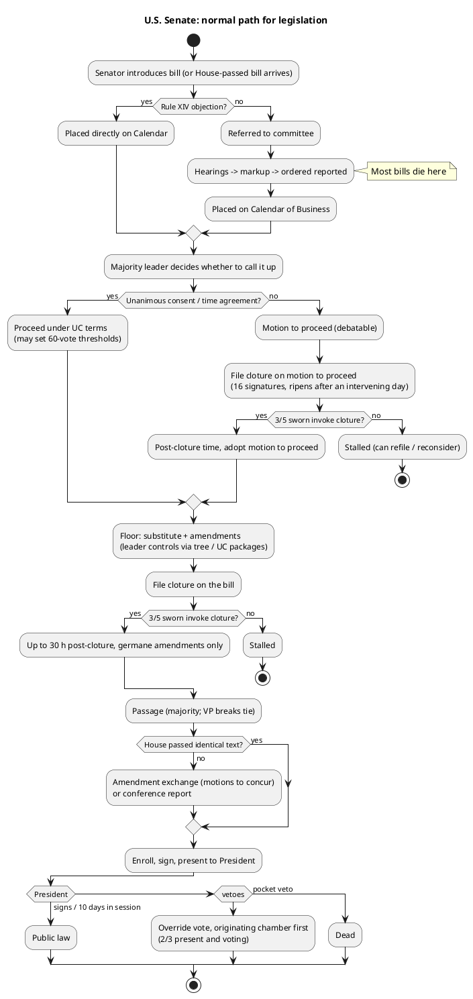

# The normal Senate path: bill to public law

## Measure types

| Prefix (Voteview `bill_number`) | Name | Goes to President? | Typical Senate use |
| --- | --- | --- | --- |
| `S` / `HR` | Bill | Yes | All ordinary law. House-numbered `HR` bills reach the Senate after House passage, or serve as **shell bills** for Senate-written revenue and appropriations text (Origination Clause) |
| `SJRES` / `HJRES` | Joint resolution | Yes, except constitutional amendments | CRs, CRA disapprovals, NEA emergency terminations, War Powers removals, AECA arms-sale disapprovals, debt-limit measures, constitutional amendments (2/3, then the states) |
| `SCONRES` / `HCONRES` | Concurrent resolution | No | Budget resolutions (the trigger for reconciliation), adjournment, enrollment corrections, War Powers §5(c) directives (non-binding after *INS v. Chadha*) |
| `SRES` / `HRES` | Simple resolution | No | Senate rules changes, committee funding, en bloc nomination resolutions (2025+), 502B human-rights information requests, impeachment trial organizing resolutions. An `HRES` in Senate data means **impeachment articles** |
| `PN` | Presidential nomination | n/a (Senate consent only) | Confirmation, executive session |
| `TREATYDOC` | Treaty document | n/a | Resolution of ratification, 2/3 |

## Step by step (legislative session)

1. **Introduction.** A senator introduces a bill and is recognized to do so. It is read twice and
   referred to committee, usually one. Joint referral needs UC. The parliamentarian advises the
   presiding officer on referral.
2. **Bypass option (Rule XIV).** If a senator objects to further proceedings after the second
   reading, the bill goes **straight to the Calendar of Business** without referral. Leaders use this
   for their priority bills and for House-passed bills they want to hold at the desk.
3. **Committee.** Hearings, then markup, then ordered reported, with or without a written report.
   Most bills die here. Committee votes are not in Voteview.
4. **Calendar.** Reported bills go on the Calendar of Business with a calendar number. Nothing moves
   from the calendar without the **majority leader**, who by precedent gets priority recognition.
5. **Getting to the bill.** There are three routes:
   - **Unanimous consent (UC).** The leader asks UC to proceed, often under a **time agreement** (a UC
     order setting debate time, amendments, and vote thresholds). A UC can even set a 60-vote
     threshold for passage or amendments, which avoids the cloture process. Watch for this when a
     passage vote "needed 60" without a cloture vote.
   - **Motion to proceed.** In legislative session it is usually debatable, so a filibuster can occur
     here. The leader files cloture on the motion to proceed (`On Cloture on the Motion to Proceed`),
     and after cloture the motion is adopted (`On the Motion to Proceed`).
   - **A non-debatable motion to proceed** set by statute: the budget resolution, reconciliation, CRA,
     NEA, war powers, AECA, ICA rescissions, trade promotion bills.
6. **Floor consideration.** The committee substitute or a leader's substitute amendment usually
   becomes the base text. Amendments are offered **only if the leader allows them**. The leader's
   priority recognition lets them **fill the amendment tree** (see exceptions.md). In practice,
   amendment votes happen through UC agreements that set an amendment package, often with 60-vote
   thresholds.
7. **Cloture on the bill** (`On the Cloture Motion`). This is the vote that ends the filibuster. It
   needs 3/5 of senators sworn. Post-cloture debate lasts up to 30 hours, and amendments must be
   germane.
8. **Passage** (`On Passage of the Bill` / `On the Joint Resolution` / `On the Resolution`). Simple
   majority of those voting. Many bills pass by UC or voice vote instead, with no roll call at all.
9. **Bicameral agreement.** Both chambers must pass identical text.
   - **Amendment exchange ("ping-pong").** Recorded as `On the Motion` with a description like
     "motion to concur in the House amendment" or "motion to concur with an amendment". This is by
     far the dominant method in 2015-2026.
   - **Conference.** Going to conference takes three debatable motions (insist or disagree, request,
     and authorize appointment), each of which may need cloture. That is why conferences became rare.
     There was **one** `On the Conference Report` vote in our 117th-119th data. NDAA bills usually
     get a negotiated "informal conference" text instead, sent back as an amendment.
10. **Enrollment.** The originating chamber's clerk prepares the enrolled bill. The Speaker and then
    the President pro tempore (or VP) sign it, and it is presented to the President.
11. **President.** 10 days (Sundays excepted) to sign or veto. If the President does nothing, it
    becomes law while Congress is in session. If an adjournment prevents return, it is a pocket veto.
    The Senate keeps pro forma sessions partly to prevent both pocket vetoes and recess appointments.
12. **Override.** The veto message goes to the originating chamber first. The Senate vote is
    `On Overriding the Veto` and needs 2/3 of those present and voting. If the first chamber fails,
    the measure is dead and the second chamber never votes.

## Thresholds cheat sheet

| Question | Threshold | Notes |
| --- | --- | --- |
| Passage, amendment, most motions, nomination | Majority of those voting | VP breaks ties; Voteview omits the VP vote |
| Cloture: legislation, motion to proceed | 3/5 of senators duly chosen and sworn | 60 with 100 sworn. Vacancies lower it: 99 sworn → 60 (59.4 rounds up), 98 → 59 |
| Cloture: nominations (all, since 2013/2017) | Majority of those voting | |
| Cloture: en bloc executive resolution (since 2025-09-11) | Majority of those voting | See executive_business.md |
| Cloture: amending the Standing Rules | 2/3 of those present and voting | Why rule changes happen by **precedent** (the "nuclear option") instead |
| Waiver of Budget Act points of order (e.g. Byrd rule, §302(f), §311, §425) | 3/5 sworn | See exceptions.md |
| Appeal of a ruling of the chair | Majority of those voting | `On the Decision of the Chair`; "Not Sustained" = the chair was overruled |
| Motion to table | Majority of those voting | Not debatable. Used to kill amendments, appeals, and points of order |
| Veto override, treaty, impeachment conviction, expulsion, constitutional amendment | 2/3 of those present and voting | |

## Flow

## Cloture mechanics (Rule XXII)

1. A cloture motion is signed by **16 senators** and filed. It can be filed on a motion to proceed, a
   bill, an amendment, a motion to concur, a conference report, or a nomination.
2. It ripens **one hour after the Senate convenes on the second day of session after filing** (one
   intervening day). A UC order often sets a specific time instead or waives the mandatory quorum call.
3. First-degree amendments must be filed by 1:00 p.m. the day after filing. Second-degree amendments
   must be filed at least one hour before the cloture vote.
4. If cloture is invoked, there are up to **30 hours** of consideration (2 hours for most sub-cabinet
   and district-court nominations since April 2019). Each senator gets 1 hour of speech. Amendments
   must be germane, and dilatory motions are out of order.
5. Leaders file several cloture motions at once to stack them ("cloture on the motion to proceed, then
   the substitute, then the bill"). Each step can burn two-plus days, so a determined minority can
   take more than a week of floor time even when it loses every vote.

## Things that end a measure without a "no" vote

- Never called up from the calendar. This is the most common fate.
- Cloture fails and the leader moves on, with the measure still on the calendar.
- The Congress ends (sine die). Every bill, resolution, and pending nomination dies except treaties.
- A point of order is sustained against it, such as a CRA resolution filed outside its window, a War
  Powers resolution held not privileged, or a Byrd-rule violation in reconciliation.
- Tabled (`Motion to Table Agreed to`), e.g. a motion to table an amendment or a motion to proceed.
