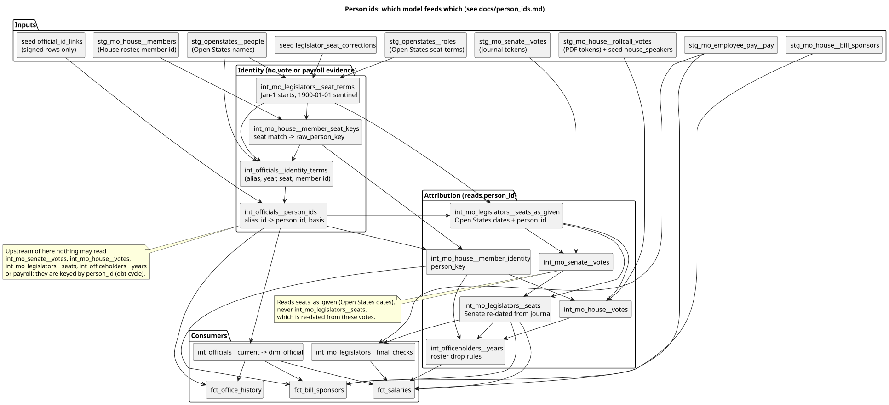

# Person ids

How the pipeline decides that ids from different sources belong to one Missouri legislator. This is the spec
for `int_officials__person_ids` and for the rules downstream that reuse the same seat dates. It describes the
rules **as the code on `main` applies them today**, with the model and the CTE (the `name as (...)` block of
the model's SQL) for each; the CTE names, unlike line numbers, stay put when a model is edited. Planned changes
are marked "planned, see #N" and are not in effect yet.

A PR that changes one of these rules updates this page in the same PR. A new identity bug is fixed as
described in [How to fix a new identity bug](#how-to-fix-a-new-identity-bug).

Contents:

- [Ids and namespaces](#ids-and-namespaces)
- [Pipeline and evidence flow](#pipeline-and-evidence-flow)
- [Rules in precedence order](#rules-in-precedence-order)
- [Downstream attribution rules](#downstream-attribution-rules)
- [Known bad inputs](#known-bad-inputs)
- [Case registry](#case-registry)
- [How to fix a new identity bug](#how-to-fix-a-new-identity-bug)

## Ids and namespaces

| id | issued by | stable? |
|---|---|---|
| `ocd-person/<uuid>` | Open States, one per Open States person record | Open States sometimes holds one person under two records (redistricting, a chamber move, a duplicate stub) |
| `mohouse:<member id>` | `int_mo_house__member_seat_keys`, when a House roster row cannot be tied to one Open States record | The House keeps one member id per person, but the fallback key changes when a later office has an Open States id |
| `mojudge:<name office circuit>` | state judges (Official Manual) | Not joined to legislator ids unless a signed `official_id_links` row says so |
| `statewide:<office>:<name key>` | statewide officers with no Open States id | Yes: the name is part of the id, so a successor in the office gets a new id (#760) |
| `bioguide:<id>`, `fjc:<nid>` | congress-legislators, the Federal Judicial Center | Stable. They are not part of the legislator rules. Federal judges without a CourtListener `fjc_id` are a known gap (#322) |

`int_officials__person_ids` maps every legislator id seen in `int_officials__identity_terms` (`alias_id`) to one
`person_id`. `person_id` is what `dim_official.official_id`, `int_officeholders__years.official_id` and the
`person_key` of the vote and roster models use.

## Pipeline and evidence flow

Source: [diagrams/person_ids.puml](diagrams/person_ids.puml)

| stage | model | reads | **may not** read (it would make a dbt cycle) |
|---|---|---|---|
| seat-terms | `int_mo_legislators__seat_terms` | `stg_openstates__roles`, `stg_openstates__people`, seed `legislator_seat_corrections` | anything keyed by `person_id` |
| House seat match | `int_mo_house__member_seat_keys` | `stg_mo_house__members`, `int_mo_legislators__seat_terms` | `int_officials__person_ids` (it feeds it), so it works on raw Open States ids |
| identity evidence | `int_officials__identity_terms` | the two above, `stg_openstates__people` | votes, payroll, `int_mo_legislators__seats` |
| person ids | `int_officials__person_ids` | `int_officials__identity_terms`, seed `official_id_links` | `int_mo_senate__votes`, `int_mo_house__votes`, `int_mo_legislators__seats`, `int_officeholders__years`, payroll. All of these attribute rows through `person_id` |
| roster identity | `int_mo_house__member_identity` | seat keys + person ids | votes |
| seats as given | `int_mo_legislators__seats_as_given` | seat-terms + person ids (Open States dates) | `int_mo_senate__votes` |
| Senate votes | `int_mo_senate__votes` | `int_mo_legislators__seats_as_given` | `int_mo_legislators__seats`, which is re-dated from these votes |
| House votes | `int_mo_house__votes` | `int_mo_house__member_identity`, `int_mo_legislators__seats_as_given`, seed `house_speakers` | `int_officeholders__years` (it reads these votes) |
| seats | `int_mo_legislators__seats` | seats as given + `int_mo_senate__votes` | `int_officeholders__years`, payroll |
| officeholders | `int_officeholders__years` | roster identity, seats, House votes | payroll |
| consumers | `fct_salaries`, `int_mo_legislators__final_checks`, `fct_bill_sponsors`, `dim_official` (via `int_officials__current`), `fct_office_history` | the above | |

What this means in practice:

- The identity rules can use only seats, dates, names, House member ids and curated links. Roll-call
  attendance and payroll cannot be evidence that two ids are one person, because both are attributed through
  `person_id`.
- Senate votes are attributed against Open States' own seat dates, and only then do those votes re-date the
  Senate seats. House votes are not used to re-date House seats in the shared seat model yet (#547 item 3).
- Evidence for cleaning Open States term dates before matching must come from staging (the House roster,
  the journal tokens in `stg_mo_senate__votes`), not from the attributed vote models. `int_mo_legislators__seat_terms`
  computes its start/end quality flags that way (#656).
- Every rule below that needs to know whether a start is known reads `start_quality` (#662), never the
  `1900-01-01` date that `int_mo_legislators__seat_terms` still puts in `start_date` for an undated start.
  `int_mo_legislators__seats_as_given` carries the flag, and `int_mo_legislators__seats` passes it on, with
  `first_vote` for an undated Senate start it re-dates from the first journal vote. A known start is
  `start_quality <> 'undated'`, so a `placeholder` start (January 1, as given) counts as known, as it did when the
  rules compared dates. The end flags (`end_quality`, `evidence_*_date`) are not read by any rule yet: the Senate
  re-dating still uses the votes `int_mo_senate__votes` attributes, which give the same dates today (#656).

## Rules in precedence order

R1 is split in two. Its `different_people` rows are applied first, before R2, R2b, R2d and R2c: they only take
ids or names out of those rules (`separated` and `keep_apart`; `member_aliases`).
R2, R2b, R2d and R2c then run in that order, and a later rule can join persons that an earlier one made. Its
`same_person` rows are applied last (`same_person` and the final select): they override every
earlier rule and move the whole person the rules made, so they never split it. The final `basis` (the final select)
is taken in this precedence: `curated` over `member_id_continuity` over `duplicate_stub` over `name_continuity`
over `self`.

### R0. House seat match (`int_mo_house__member_seat_keys`)

Gives each House roster row (session, member) a `raw_person_key`. This is not a `person_ids` row; it is the
House roster's key that `person_ids` then reconciles.

1. **Candidates** (`candidates`): Open States House terms in the member's district whose dates
   (January-1 adjusted `start_date`, so an undated start is `1900-01-01` and the term covers every session
   before its end; `start_quality` is not read) cover March 1 of the session year, with a surname that
   fits: equal, the roster surname ends with the Open States surname, or the Open States full name ends with
   the roster surname.
2. **Seat match** (`seat_match`), grouped by (session, district): one candidate wins. With several, the one
   whose Open States name starts with the member's given name and a space wins, if exactly one does
   (Joe Don vs Peggy McGaugh, #136).
3. **Name anchors** (`name_anchors`, applied in `resolved`): a member id whose other sessions matched exactly one
   Open States person by given name keeps that person when a session's seat match lands on someone else (Rebecca
   Roeber listed in 2020 in Rick Roeber's seat, #152). A member id anchored to two people (duplicate Open States
   records, member 2235 Cook) keeps the seat match.
4. **Fallback** (`raw_person_key` in the final select): no match gives `mohouse:<house member id>`.

- Evidence: roster district, session year, surname, given name. No votes.
- Tests: unit tests `house_seat_match_breaks_same_surname_ties_on_given_name`,
  `house_departed_member_keeps_own_person_when_roster_outlives_term`,
  `house_member_with_two_given_name_anchors_keeps_the_seat_match`,
  `house_given_name_anchor_ends_at_a_word_boundary` (#498) (`_intermediate__person_ids_unit_tests.yml`); data test
  `unique_combination_of_columns(session_code, district_number)` (`_intermediate.yml`), because grouping by seat,
  not member, could hand one member's id to a mid-session replacement (#475).
- Must withstand: undated same-surname terms (#136), a roster that outlives a member (#152), duplicate Open States
  records, a new Open States record after redistricting (#97: handled later by R2, not here).

### R1. Curated `official_id_links` (`int_officials__person_ids.sql`: `signed_links`, `separated`, `keep_apart`, `member_aliases`, `same_person`)

The seed `official_id_links.csv` holds reviewed pairs, each with a `relation`:

- `same_person`: the whole person the rules merged the row's `alias_id` into takes the `person_id` the rules
  gave the row's `person_id` (`same_person`, joined on the merged `person_id` in the final select),
  `basis = curated`. Both sides are read through the merged persons, so a row may name any id of either person
  and never splits one (#174 item 3):
  - alias side: a row naming an id the rules merged but did not choose (a `mohouse:` fallback key) still moves
    every id of that person.
  - target side (#682): a row whose `person_id` is an id the rules merged into another id points at that
    person's chosen id instead, so the moved person joins the target's whole person. A `person_id` the rules
    never saw (a `mojudge:` id) is used as written. The target's own ids keep the `person_id` and `basis` the
    rules gave them; only the moved person's ids become `curated`.

  Two signed rows that send one merged person to different ids are a seed error; the smaller resolved `person_id`
  wins, so the output stays deterministic (unit test
  `person_ids_take_the_smallest_resolved_target_of_two_curated_links`). The resolution is one step: a row whose
  target person is itself moved by another signed row (a chain, A -> B and B' -> C with B' in B's person) is not
  followed further, so A's person would land on B's chosen id while B's person moves to C. The model stays single
  pass; instead the data test `assert_signed_same_person_links_end_in_one_person` (error, #691) fails the build when
  any signed `same_person` row ends with its `alias_id` and its `person_id` in different persons (a `person_id` the
  model never saw, a `mojudge:` id, is compared as written). That catches a chain and two rows sending one person to
  different persons alike; fix the seed by pointing every row at the final person. A signed row whose `alias_id` the
  model never saw (a typo) would be dropped by both the model and that test, so the seed's `relationships` test on
  `alias_id` (to `int_officials__person_ids.alias_id`, signed `same_person` rows only, `dbt/seeds/_seeds.yml`, #688)
  fails the build on it. Rows that only restate a person the rules already made (Stephen Webber's, or rows in both
  directions) leave the rules' chosen `person_id` in place and make every id of it `curated` (unit test
  `person_ids_keep_the_chosen_id_when_curated_links_join_ids_already_one_person`). Used for ids no seat rule can
  reach (a legislator who became a state judge).
- `different_people`: the name of either id is kept out of R2, R2b and R2d (`keep_apart`), and the ids are kept
  out of R2c (`member_aliases`).

A row has an effect only when signed: `checked_by` and `checked_on` both filled (`signed_links`,
#174 item 1). The model ignores a row with only one of them, and the seed's `dbt_utils.expression_is_true` test in
`dbt/seeds/_seeds.yml` (`checked_by` and `checked_on` both empty or both filled) fails the build on it, so a
half-signed row cannot sit unnoticed. `assert_person_ids_name_continuity_gaps_plausible` exempts a pair on the
same two-field sign-off. The exemption covers only the pair the row names: every id of the moved person is
`curated`, including ids the name rules joined to the named id, so that test checks `curated` persons as well
as `name_continuity` ones (#682). An id the name rules wrongly joined to a signed person is still listed, not
hidden behind the label.

- Tests: `person_ids_follow_a_curated_link_to_a_judge`, `person_ids_ignore_unsigned_curated_links`,
  `person_ids_ignore_half_signed_curated_links`,
  `person_ids_redirect_the_whole_group_from_a_curated_link_to_a_non_chosen_alias`,
  `person_ids_join_the_whole_target_person_of_a_curated_link_to_a_non_chosen_alias` (#682),
  `person_ids_keep_a_different_people_pair_apart`,
  `person_ids_keep_a_signed_different_people_pair_apart_across_given_name_variants`,
  `person_ids_keep_a_signed_different_people_id_out_of_the_house_member_id_rule`.
- Today: two rows. Joe Don McGaugh (Open States id to his `mojudge:` id) is unsigned, so it changes nothing.
  Stephen Webber (his two Open States ids, already joined by R2) is signed (#663), so both his ids are
  `basis = curated`; his `person_id` is unchanged, the id R2 chose (`ocd-person/63dea1c8-…`, his Senate id).

### R2. Exact name, spaces ignored (`alias_names`, `aliases`, `seat_conflicts`; grouped in `keyed`, `ranked`, `name_person`)

Ids whose full name keys are equal with spaces removed (`sq`; "Van Schoiack" = "VanSchoiack", #228) are one
person, `basis = name_continuity`. An id's name is `max(name_key)` over its identity rows (`alias_names`). A
roster row's name is the Open States name when it matched one (its alias is then the Open States id); a
`mohouse:` id carries the roster's own name (`house_terms` in `int_officials__identity_terms.sql`;
`raw_person_key` in the final select of `int_mo_house__member_seat_keys.sql` gives `mohouse:` only when no Open
States id matched).

- **Seat-conflict exception** (`seat_conflicts`): if two ids of the name hold different seats (office or district)
  in **more than one** shared year, the whole name is kept apart and every id of it stays `self` under the name
  rules (R2, R2b). R2c can still join them through a shared House member id, unless a signed
  `different_people` row excludes them. One shared year is allowed: a hand-over (Lauren Arthur in HD18 and
  SD17 in 2018).
- No check on the gap between the ids' years or on how far apart the seats are (#174 item 2). The data test
  `assert_person_ids_name_continuity_gaps_plausible` (error, #660, #663) lists a merged id whose years neither
  touch another id of its person nor return to the same seat within 8 years; it lists nothing today. Stephen
  Webber would be listed on his name alone; his signed `same_person` row makes him `curated` and exempts his
  pair (#663).
- An undated id has one evidence year, so it can never show a seat conflict (#519). The data test
  `assert_undated_open_states_ids_share_no_name` fails if such an id shares a name with another id.
- Tests: `person_ids_join_a_redistricted_seat_change`, `person_ids_join_a_house_fallback_key_to_the_senate_record`,
  `person_ids_join_a_same_seat_split`, `person_ids_keep_same_name_in_two_seats_the_same_year_apart`,
  `person_ids_join_a_one_year_hand_over_between_seats`, `person_ids_ignore_spacing_inside_a_surname`,
  `person_ids_join_an_undated_open_states_term_to_a_roster_key_in_the_same_seat`.
- Must withstand: redistricting (#97), `mohouse:` fallbacks (#97, #491), spacing variants (#228), undated ids
  (#512, #519).

### R2b. Given-name prefix variants (`name_spans`, `name_terms`, `variant_pairs`, `variant_counts`, `name_groups`)

Two names that differ only in the given name, one given name the start of the other, both at least 3 letters
("Steve"/"Steven", "Ken"/"Kenneth", #263), are one person, `basis = name_continuity`, when all of these hold:

1. The names never hold different seats in the same year, across every id of both names (the first
   `not exists` in `variant_pairs`).
2. Either:
   - **shared-seat stub** (the overlap `exists` in `variant_pairs`): their dated terms in one seat overlap (`start_a
     < end_b and start_b < end_a`), and one term is a stub under 90 days nested in the other and starting within 31
     days of it. Overlap alone is not enough: Open States leaves a mid-term departure at the normal term end, so a
     special-election successor overlaps on paper (#313); and two different people can hold the same placeholder
     `2013-01-01` term (#332). Roster rows have no dates and prove no overlap. The test reads `term_start`, Open
     States' start as given: a `placeholder` term takes part with its January 1 date (the stub guard keeps two
     same-span placeholder terms apart), and an `undated` term has no `term_start`, so it is never part of an
     overlap.
   - **chamber move** (the two year-apart branches of `variant_pairs`): one name's last year is the year before the
     other's first, those two years are in different offices, and not in the same office. The same chamber a year
     apart is a successor (Dan, then Danielle Smith).
3. Neither name is in `keep_apart` (R2's seat conflict, or a signed `different_people`; the last two conditions
   of `variant_pairs`).
4. Each name has exactly one such partner (`variant_counts`, `name_groups`): a chain or fork ("Sam" with "Samuel"
   and "Sammy") joins nothing.

- Tests: `person_ids_join_a_given_name_variant_across_chambers`, `person_ids_join_a_given_name_variant_in_the_same_seat`,
  `person_ids_keep_placeholder_start_same_span_given_name_variants_apart`,
  `person_ids_keep_a_long_term_nested_in_a_longer_one_given_name_variants_apart`,
  `person_ids_keep_a_same_end_later_start_successor_apart`,
  `person_ids_keep_a_same_seat_successor_with_a_hand_over_year_apart`,
  `person_ids_keep_a_successor_who_holds_only_the_first_year_of_the_seat_apart`,
  `person_ids_keep_a_mid_year_special_election_successor_apart`, `person_ids_keep_a_mid_term_departure_successor_apart`,
  `person_ids_keep_given_name_variants_serving_at_once_apart`, `person_ids_keep_given_name_variants_far_apart_apart`,
  `person_ids_join_no_given_name_variant_with_two_candidates`,
  `person_ids_keep_given_name_variants_apart_when_another_id_holds_a_different_seat`,
  `person_ids_keep_a_successor_in_the_same_seat_apart`; `identity_terms_carry_open_states_dates_untruncated`
  (the rule needs the unadjusted dates).
- Must withstand: mid-term departures recorded with the normal end (#313), placeholder starts (#332), undated
  ids (#519: the chamber-move check compares first and last year, the same year for an undated id).
- Does not cover: Martin/Marty Jacobs (#292, not a prefix) or David Dolan/David A. Dolan (#294, a middle initial).
  Both are the same 26-day 2025 duplicate stub as Kenneth Jamison; R2d joins them (#661).

### R2d. Duplicate stubs (`stub_terms`, `stub_candidates`, `stub_links`, `stub_groups`)

Open States holds some members twice, once as a short stub record (#292, #294). An Open States id joins another
name, `basis = duplicate_stub`, when all of these hold:

1. **The id is a stub** (`stub_terms`): its only seat-term (one office and district, start and end
   both given) lasts under 90 days. `mohouse:` ids are never stubs.
2. **Another name's term contains it** (`stub_candidates`): a term of another name in the same
   office and district that lasts 90 days or more, starts on or before the stub's start and at most 7 days before
   it, and ends on or after the stub's end. A special-election successor never qualifies: its term starts on or
   after the predecessor's ends, or, when Open States leaves a departed member with the normal term end, months
   after the predecessor's term starts.
3. **The surnames match** (`stub_candidates`): the names after the given name are equal, or equal once one side
   drops a leading one-letter middle initial ("David A. Dolan" and "David Dolan"; not "David B. Dolan" and
   "David A. Dolan"), and the other name has a non-empty surname (`length(oa.core) > 0`), so a one-word name
   never takes a stub.
4. **The given names fit** (`stub_candidates`): `mogov.first_name_fit` of at least 1 (equal, one the start of the
   other, or the same first three letters: "Martin" and "Marty"; not "Daniel" and "Robert").
5. **Exactly one candidate** (`stub_links`): a stub name that fits two other names joins neither.
6. **Guards** (`stub_groups`): every id of the stub's name is such a stub (a name that also has a
   full term is a person of its own); neither name is in `keep_apart` (R2's seat conflict, or a signed
   `different_people` row: listing either id is the maintainer's way to undo a wrong R2d join); the stub name is
   not already in an R2b pair (Kenneth / Ken Jamison is left to R2b); the other name is not itself a stub name
   (no chains).

The stub's name joins the other name's group (its R2b group, if it has one), so R2c still applies to the joined
person. Only the stub name's ids get `basis = duplicate_stub`, and only when they are not the chosen id; a stub
ranks below a non-stub with the same last year when the person_id is chosen.

- Tests: `person_ids_join_a_duplicate_stub_with_a_middle_initial`, `person_ids_join_a_duplicate_stub_with_a_nickname`,
  `person_ids_keep_a_same_day_stub_with_another_given_name_apart`,
  `person_ids_keep_a_stub_that_starts_after_the_other_term_ends_apart`,
  `person_ids_keep_a_stub_late_in_a_departed_members_term_apart`, `person_ids_join_no_duplicate_stub_with_two_candidates`,
  `person_ids_keep_a_stub_apart_when_its_name_has_another_id`, `person_ids_join_no_chain_of_duplicate_stubs`,
  `person_ids_keep_a_duplicate_stub_apart_when_its_name_is_signed_different_people`,
  `person_ids_keep_a_duplicate_stub_apart_when_the_other_name_is_signed_different_people`,
  `person_ids_keep_a_same_seat_stub_with_another_surname_apart`.
- Today: 2 ids, Martin Jacobs (HD38) joined to Marty Jacobs and David A. Dolan (HD148) joined to David Dolan.
- Must withstand: mid-term departures recorded with the normal end (#313), special-election successors.

### R2c. House member id continuity (`member_aliases` to `member_person`, applied in `merged`)

The House keeps one member id per person across sessions and name changes (Mazzie Boyd 2023 and Mazzie
Christensen 2024-26 are member 2381, #151). Ids that share a member id are one person whatever their names,
`basis = member_id_continuity`.

- Runs after R2/R2b/R2d and joins the persons they made, not just the single ids (`member_persons`,
  `member_anchors`, `person_anchors`, `member_groups`).
- Skips an id that carries more than one member id (`member_aliases`): Open States' Rick Roeber also holds Rebecca
  Roeber's member 1790 through the 2020 seat-match error (#152). Skips signed `different_people` ids (also
  `member_aliases`).
- Only ids with a roster row take part; Senate-only ids rely on the name rules.
- A single pass, not connected components: a chain across three persons can stay split. The data test
  `assert_house_member_id_one_person` flags leftovers.
- Tests: `person_ids_join_a_name_change_by_house_member_id`, `person_ids_join_the_whole_person_a_member_id_reaches`,
  `person_ids_keep_ids_apart_when_they_carry_no_shared_house_member_id`,
  `person_ids_skip_a_key_that_carries_two_house_member_ids`,
  `person_ids_keep_a_signed_different_people_id_out_of_the_house_member_id_rule`.

### R3. Otherwise `self`

The id is its own person, `basis = self`.

### Choosing the person_id (`keyed`, `ranked`, `name_person`; `member_ranked`, `member_person`)

Among the merged ids, in order: an Open States id over a `mohouse:` one, then the id whose identity years end
latest, then the one that is not an R2d duplicate stub, then the smallest id. R2c picks among the persons it joins
with the same keys except the stub one (`member_ranked`). The last key is unique, so the choice is deterministic. It
never looks at who serves in the latest roster year, so an official's id does not change when they leave office.

- Test: `person_ids_keep_the_id_after_the_official_leaves_office`; data tests `assert_official_ids_one_per_person`,
  `assert_recent_seat_term_ids_have_person_ids`.

### What the evidence is (`int_officials__identity_terms`)

One row per (alias, year, office, district, House member id) for each House roster year plus the two years before
the first one (`all_years` and `years`, so Stephen Webber's House term ending 2016-12-31 still counts, #504, and the
2015 resignations, #512). A term counts for a year when it runs past January 15 (the `years` join in `seat_terms`).
A term with `start_quality = 'undated'` counts only for its last year (the `where` of `seat_terms`; `undated_terms`,
`undated_seat_terms`). A `placeholder` start counts like a dated one (#662): 69 placeholder terms (2011, 2013, 2015
and one 2017 start) run into the 2015+ evidence years for 163 term-years. Counting them as undated would drop 94 of
those years and change no `person_id` (measured on a full build, 2026-10-27), so they are kept.
`term_start`/`term_end` are Open States' own dates, not the January-1 adjusted ones (`term_start`/`term_end` in
`seat_terms`). Known edge: one id holding a seat in two terms in one year is collapsed to one span
(`identity_terms_collapse_two_terms_of_one_id_in_a_seat_to_one_span`).

## Downstream attribution rules

These rules do not make person ids, but they tie rows to people by the same seat dates, so a bad date breaks
them the same way.

### Senate journal tokens (`int_mo_senate__votes.sql`: `candidates`, `unique_match`)

A token matches a senator whose seat (`int_mo_legislators__seats_as_given`: Open States dates, January-1
adjusted, undated starts from `1900-01-01`) covers the vote date, whose surname key equals the token or is its
last word, and whose district equals the token's district when the journal prints one. Exactly one person or the
token stays unattributed.

- Tests: `senate_vote_tokens_match_senator_serving_on_the_date`; data tests `assert_senate_vote_tokens_attributed`
  (error), `assert_senate_seats_sum_to_34`.

### House roll-call tokens (`int_mo_house__votes.sql`: `matches` to `unique_match`)

- "MR SPEAKER" is matched by the seed `house_speakers` district for the year (`speaker`).
- Other tokens match a roster member by name (the `members` join in `matches`), with a name rank (`name_rank`
  in `matches`): 1 the whole surname
  with spaces ignored (or the start of a surname of 13 or more letters, which the PDF truncates); 2 the surname
  without a generational suffix ("PRICE" for Wiley Price IV); 3 the last word of a compound surname ("REHDER" for
  Holly Thompson Rehder). A district in the token must match.
- **Same session first.** Members of the vote's own session outrank every other session's members. In the same
  session the better name rank wins, so the exact surname beats the suffix-stripped one (#581).
- **Cross-session fallback.** The roster is an end-of-session list, so a member who left mid-session is only in
  other sessions' lists. There a person whose dated Open States seat in that district missed the vote date is
  ruled out, even when alone (the `where` of `candidates`), and a person whose seat covered the date outranks one
  with no dated seat, before name rank (`tier` in `candidates`: session, then coverage, then name rank).
- **Seat-date tie-break** (`best_candidates`, `unique_match`): among the best tier, a candidate whose dated seat
  missed the date is dropped when another candidate's seat covered it. A candidate with no dated seat is never
  dropped. Exactly one person or the token stays unattributed.
- Tests: `house_vote_tokens_attribute_to_one_member_or_none` (`_intermediate__unit_tests.yml`),
  `house_vote_tokens_match_compound_and_suffixed_surnames`, `house_vote_tokens_shared_surname_resolved_by_seat_dates`,
  `house_vote_tokens_cross_session_fallback_uses_seat_dates`, `house_vote_tokens_exact_surname_beats_suffix_stripped`
  (`_intermediate__mo_house_votes_unit_tests.yml`); data test `assert_house_vote_tokens_attributed` (warn) and,
  at error level, `assert_vote_attribution_share_per_session` (#660, from #629 item 3).
- Open: in the fallback, seat coverage outranks name fit, which can pick the wrong person in a rare shape, and
  there is no grace window for a seat that ends just before the vote (#629 items 1-2). Open States House dates
  disagree with attendance for many members (#565), so they are only a tie-break, never a hard filter in the own
  session.

### Senate seat re-dating (`int_mo_legislators__seats.sql`: `dated` and the final select)

Senate terms are re-dated from the journal votes attributed to them, term by term (#516, #522):

- an undated start (`start_quality = 'undated'`) becomes the term's first vote, and its `start_quality` becomes
  `first_vote` (`is_first_vote_start` in `dated`; `start_date` and `start_quality` in the final select);
- a closed term that Open States ends more than a year after its last vote ends at that vote (`end_date` in `dated`);
- a closed term in the journal years with no vote ends the day before the journals begin if it started before
  them (a known start: `start_quality <> 'undated'`, placeholders included), else it is dropped (`is_unvoted`
  in `dated`; `end_date` and the `where` of the final select);
- dropping or capping needs journal votes in every year of the term (`term_years`, `term_coverage`, #534).

House terms keep Open States' dates.

- Tests: `senate_seat_terms_dated_from_the_journal_roll_calls_per_term`, `senate_seat_terms_untouched_when_the_journal_is_empty`,
  `senate_seat_terms_untouched_when_a_journal_year_is_missing`, `senate_seat_terms_untouched_when_the_journal_stops_early`
  (`_intermediate__seats_unit_tests.yml`); data test `assert_senate_terms_have_votes`.

### House roster drop rules (`int_officeholders__years.sql`: `last_house_term`, `last_house_vote`, `rollcall_years`, `house`)

A House roster row is kept for a year unless either:

1. the row carries an Open States id and that person's last Open States House term ended on or before January 15 of
   the year (the `where` of `house` keeps it only when `last_end_date > handover_date`, #152). In practice this
   fires only on rows the name-anchor override assigned; or
2. the person's last attributed roll-call vote was before January 15, in a year that has House roll calls on or
   after January 15 (the same `where`, #491). The Speaker is attributed from the seed, so this works for Speakers too.

A Senate year is kept only when all 34 districts have a holder with a known start (`start_quality <> 'undated'`
in `int_mo_legislators__seats`, which counts a start re-dated from the first vote; `senate_terms`,
`senate_complete_years`, `senate`).

- Tests: `officeholders_house_row_dropped_when_the_roster_outlives_the_members_last_term`,
  `officeholders_house_row_dropped_when_the_members_last_roll_call_is_before_the_handover`,
  `officeholders_house_roster_kept_whole_in_a_year_with_no_roll_calls_after_the_handover`,
  `officeholders_senate_seats_as_dated_by_the_seat_table`; data tests `assert_officeholders_every_year_has_both_chambers`,
  `assert_officeholders_per_year_plausible`.
- Open: a member whose later votes go unattributed could be dropped for a year they served (#547 item 1).

### Payroll pairing (`fct_salaries.sql`: the by-seat CTEs `first_roster_years` to `by_seat`; `int_mo_legislators__final_checks.sql`)

Legislator pay is paired by seat: payroll surname + chamber + year against every person's seats in
`int_mo_legislators__seats` (`seat_years`), then by first-name fit, middle initial and the last pair left (the
model's header comment lists the four steps). A seat with an undated start counts from the person's first roster
year in that chamber (`start_quality = 'undated'`; `first_roster_years`, `seat_years`, #227). A small payment to a
member whose seat ended the December before, or that January, is that member's final check (the final select of
`int_mo_legislators__final_checks`) and is set aside before pairing.

- Senate last-vote cap: Ryan Silvey's SD17 seat ends at his last vote, 2017-09-13, so his 2018 payment ($1,836.67,
  about 19 days) is not a final check (his seat did not end in December or January) and is not tied to his seat.
  Will Kraus (SD8, last vote 2017-07-25) has no 2018 pay, so the cap agrees with payroll for him. This is today's
  behaviour (option 1 of #551, a `needs-user` decision). Today neither has any `fct_salaries` row at all: the seat
  pairing keeps only officials in `dim_official` (the `dim_official` join in `by_seat`), which lists current
  officials, and neither Silvey nor Kraus is one.
- Tests: the `salaries_*` tests in `_marts__salaries_unit_tests.yml` and the `final_checks_*` tests in
  `_intermediate__final_checks_unit_tests.yml`; data test `assert_salaries_final_checks_not_paid_again_later`.

### Bill sponsors (`fct_bill_sponsors.sql`: `house_match`, `redistricted_match`, `switch_match`, `senate_match`, `matches`)

A representative is matched on (session, listed district) through the House roster with the surname inside the
sponsor name (`house_match`). The House XML lists a member's latest district for every session, so after the
2022-23 redistricting a member also matches on (session, surname, given name) among roster members who held the
listed district in some session, but only when no member of the listed district fits the sponsor name that
session (the `not exists own` check in `redistricted_match`, #636). A House-era row listed as 200 + a senate district
matches a House roster member of that session (surname and given name) who held that senate seat at any time,
before or after; the model does not check that the senate seat came later (`switch_match`, #646). A senator matches
the senate seat held that year (`senate_match`). Two candidate people leave the row unmatched.

- Tests: `bill_sponsors_match_redistricted_members_by_surname_and_held_district`,
  `bill_sponsors_classify_house_era_rows_of_members_who_moved_to_the_senate`, `bill_sponsors_skip_relisted_bills`;
  data test `assert_bill_sponsors_roster_members_matched`.

### Profiles and office history

`int_officials__current` (`senators`, `statewide`) sets `official_id = coalesce(person_id, openstates_id)`, which
becomes `dim_official.official_id`. `fct_office_history` (`os_roles`) collects Open States roles under every alias
of the person.

## Known bad inputs

Counts were measured on 2026-10-27 on a copy of the local DB, with the models from origin/main rebuilt from
`+int_officeholders__years +fct_salaries +fct_bill_sponsors` and the seeds reloaded. The raw data is the
local load, which may be older than the sources today.

| bad input | count today | how it is handled | issues |
|---|---|---|---|
| Undated Open States starts (`1900-01-01` sentinel in `int_mo_legislators__seat_terms`) | 198 terms (173 House, 25 Senate), all ending 2018-12-31 to 2023-01-04 | Identity: last year only (R2 evidence). Senate: dated from the first journal vote (all 25). House: R0 treats them as covering everything before their end; payroll counts them from the first roster year | #136 #227 #512 #516 #519 |
| January-1 starts that are placeholders (`2011-01-01`, `2013-01-01`, `2015-01-01` in the source) | 221 terms (194 House, 27 Senate); 11 of these 221 still run past 2017-01-15 (12 of the 222 below, with Schroer's). The four `2015-01-01` ones (Cloria Brown, Justin Alferman, Nick King, Lauren Arthur) all end 2016-12-31. `start_quality = 'placeholder'` flags any January-1 start, so 222 terms: these plus one `2017-01-01` start, Nick Schroer HD107, near-true (his first term began with the session on 2017-01-04) | R2b needs a short stub, so equal or nested placeholder terms never join | #332 #656 #675 |
| Seed starts (`legislator_seat_corrections`) | 3 rows: Wayne Wallingford SD27 from 2013-01-09; Mike Kehoe SD6 and Mike Parson SD28 from 2017-01-01 | A seed row with a start is always `start_quality = 'dated'` and taken at face value, January 1 included; a seed row with a blank start is `undated`. A seed start is where the correction begins, not a first start: Kehoe's and Parson's 2017-01-01 continue terms Open States starts on 2011-01-01 | #656 #675 |
| Open States ends that are really mid-term departures, or wrong ends | Senate: the ends of 6 terms re-dated (Keaveny, Schmitt, Schaefer, Pearce end 2017-01-03, the day before the journals begin; Kraus capped at 2017-07-25, Silvey at 2017-09-13). House: Lauren Arthur HD18 ends 2016-12-31 though she voted through 2018 | Senate: re-dating from the journal. House: no re-dating; R2's one-year hand-over joins her roster key to her Senate id | #313 #491 #522 #525 |
| 2025-01-08 to 2025-02-03 duplicate stub records | 3: Kenneth Jamison (HD15), David A. Dolan (HD148) and Martin Jacobs (HD38) | Kenneth by R2b (a given-name prefix); Dolan and Jacobs by R2d, `basis = duplicate_stub` (the 2 `duplicate_stub` aliases below) | #263 #292 #294 #661 |
| Redistricting 2022-23 | 27 `name_continuity` aliases in all; the redistricted ones are among them | R2 (same name, different seats in different years); bill sponsors match on the held district | #97 #636 |
| Name variants | spacing (Van Schoiack), given-name prefixes (Steve/Steven Roberts, Ken/Kenneth Jamison), name change (Mazzie Boyd/Christensen, the 1 `member_id_continuity` alias) | R2 `sq`, R2b, R2c | #152 #228 #263 #504 |
| `mohouse:` fallback ids | 14 raw keys on 72 roster rows (30 in 2017, 27 in 2018); every one is joined to an Open States id, so no `mohouse:` person key is left | R2 / R2c | #97 #491 |
| Roster rows that outlive a member | 3 rows dropped: Mike Cierpiot 2018 (HD30), Scott Fitzpatrick 2019 (HD158), Rebecca Roeber 2020 (HD34) | Roster drop rules | #152 #491 |
| Vote tokens: compound surnames, suffixes, truncation, shared surnames | 0 of 967,853 House vote rows unattributed (6.4k before #539); 0 of 75,677 Senate | Token rules above | #539 #581 #629 |
| House seat dates vs roll-call attendance | 13,133 attributed House votes fall outside every Open States House seat of that person (`int_mo_legislators__seats_as_given`): 11,773 by people with an Open States House seat (plus 1,360 by Cierpiot, 681, and Crawford, 679, who have none). Most are from the 2017 class: PHILLIPS and ADAMS 1,545 each, ALFERMAN, ARTHUR, CORNEJO, MCCANN BEATTY, RHOADS 1,532 each | House seat dates are only a tie-break | #565 |
| Senate last-vote cap vs payroll | Silvey and Kraus (above) | Today: the cap (option 1) | #551 |
| Federal judges without an `fjc_id` | Sarah Pitlyk and 6 newer judges (from the issue, not re-measured) | Out of scope for legislator ids: a known gap | #322 |
| Unsigned curated rows | `official_id_links.csv` has 1 unsigned row (Joe Don McGaugh, Open States id to `mojudge:`), `checked_by` empty; Stephen Webber's row is signed (#663) | No effect until signed | #174 #663 |

In all, `int_officials__person_ids` has 501 aliases and 471 persons: 470 `self`, 26 `name_continuity`, 2
`duplicate_stub`, 1 `member_id_continuity`, 2 `curated` (Stephen Webber, #663). Data tests `assert_official_ids_one_per_person`,
`assert_house_member_id_one_person`, `assert_undated_open_states_ids_share_no_name`,
`assert_recent_seat_term_ids_have_person_ids`, `assert_senate_terms_have_votes`,
`assert_senate_vote_tokens_attributed`, `assert_house_vote_tokens_attributed`,
`assert_vote_attribution_share_per_session`, `assert_officeholders_every_year_has_both_chambers`,
`assert_salaries_final_checks_not_paid_again_later`, `assert_salaries_legislature_pay_within_held_terms` and
`assert_bill_sponsors_roster_members_matched` pass on that copy, and so does
`assert_person_ids_name_continuity_gaps_plausible` (error since #663).

## Case registry

One row per person named in the issues of #649. "Test" names an existing unit test that pins the person's
shape (often with the person's own name in the fixture). `TODO (#N)` means child issue #N adds the fixed-input
test. Each subsection belongs to one child issue, so their PRs edit only their own table.

### Person ids and House seat match

Owner: #657. "named" tests are in `_intermediate__person_ids_cases_unit_tests.yml` and use the person's real
ids, seats and dates; "shape" tests are the older ones with invented people. A case marked *not breakable
here* has a named `person_ids_cases_*` test that only checks that nothing goes wrong (no wrong merge or split);
the test after "protected by", where given, is the one that fails if the case breaks.

| person | issues | model | rule | test |
|---|---|---|---|---|
| David Tyson Smith (HD45 to HD46), Bennie Cook, Josh Hurlbert, Bill Hardwick, Mark Matthiesen (redistricting) | #97 | `int_officials__person_ids` | R2, redistricting (basis `name_continuity`, not `member_id_continuity`) | named: `person_ids_cases_join_redistricted_seat_changes`; shape: `person_ids_join_a_redistricted_seat_change` |
| Peggy McGaugh (one Open States id across HD39 and HD7) | #97 | `int_officials__person_ids` | stays one person | named: `person_ids_cases_join_redistricted_seat_changes` *(not breakable here: she is a single id, so no person-id rule can split her; a no-regression check only)* |
| Bennie Cook (member 2235, two Open States records) | #97 | `int_mo_house__member_seat_keys` | R0 name anchors | `house_member_with_two_given_name_anchors_keeps_the_seat_match` |
| Mike Cierpiot (`mohouse:476` to SD8), Sandy Crawford (`mohouse:478` to SD28) | #97 #136 | `int_officials__person_ids` | R2, fallback key; one shared year is not a seat conflict | named: `person_ids_cases_join_house_fallback_keys_to_the_senate_record`; shape: `person_ids_join_a_house_fallback_key_to_the_senate_record`, `person_ids_join_a_one_year_hand_over_between_seats` |
| Scott Fitzpatrick (`mohouse:648`, later State Treasurer and Auditor) | #97 #491 | `int_officials__person_ids` | R2, fallback key | named: `person_ids_cases_join_scott_fitzpatricks_fallback_key_to_his_house_record`; shape: `person_ids_join_a_house_fallback_key_to_the_senate_record` |
| Curtis Trent, Mary Elizabeth Coleman, Rusty Black, Tracy McCreery (House to Senate) | #97 | `int_officials__person_ids` | R2; the Senate id is kept | named: `person_ids_cases_join_house_to_senate_moves`; shape: `person_ids_join_a_house_fallback_key_to_the_senate_record` |
| Adam Schwadron, Deb Lavender, Jean Evans (HD99, `mohouse:1912`), Joe Adams (`mohouse:1780`), Lauren Arthur (HD18 2017-18 as `mohouse:1810`, SD17 from 2018) | #97 #491 | `int_officials__person_ids` | R2, same-seat split and one-year hand-over; the Open States id wins over the `mohouse:` key | named: `person_ids_cases_join_same_seat_splits`; shape: `person_ids_join_a_same_seat_split`, `person_ids_join_a_one_year_hand_over_between_seats` (Arthur) |
| Joe Don McGaugh (HD39 2017, vs Peggy McGaugh's undated term) | #97 #136 #475 | `int_mo_house__member_seat_keys` | R0 given-name tie-break: resolves to his own Open States id (044d5678), not `mohouse:658` | named: `house_seat_keys_cases_joe_don_mcgaugh_keeps_his_own_id`; shape: `house_seat_match_breaks_same_surname_ties_on_given_name` |
| Joe Don McGaugh (to `mojudge:`) | #97 #174 | `int_officials__person_ids` | R1 curated (unsigned) | `person_ids_follow_a_curated_link_to_a_judge`, `person_ids_ignore_unsigned_curated_links` |
| Dan vs Daniel (word boundary of the given-name anchor) | #475 #498 | `int_mo_house__member_seat_keys` | R0 given-name anchor | shape: `house_seat_match_breaks_same_surname_ties_on_given_name` (Dan Pratt row), `house_given_name_anchor_ends_at_a_word_boundary` |
| Mazzie Boyd / Mazzie Christensen (member 2381) | #151 | `int_officials__person_ids` | R2c, basis `member_id_continuity` | named: `person_ids_cases_join_a_name_change_by_house_member_id`; shape: `person_ids_join_a_name_change_by_house_member_id` |
| Rebecca Roeber (HD34, 2020 roster rows) / Rick Roeber | #152 | `int_mo_house__member_seat_keys` | R0 name anchors: the 2020 rows keep her id (ad28c002), not Rick's (cd0a84e5) | named: `house_seat_keys_cases_rebecca_roeber_keeps_her_own_id_in_2020`; shape: `house_departed_member_keeps_own_person_when_roster_outlives_term` |
| Rick Roeber (holds members 2215 and 1790) / Rebecca Roeber | #152 | `int_officials__person_ids` | R2c skip: Rick stays apart; Rebecca's two ids join | named: `person_ids_cases_keep_rick_and_rebecca_roeber_apart`; shape: `person_ids_skip_a_key_that_carries_two_house_member_ids` |
| Rebecca Roeber (undated Open States term) | #152 #512 | `int_officials__person_ids` | R2 with undated evidence | named: `person_ids_cases_keep_rick_and_rebecca_roeber_apart`; shape: `person_ids_join_an_undated_open_states_term_to_a_roster_key_in_the_same_seat` |
| Dean Van Schoiack / VanSchoiack (`mohouse:2243`) | #228 | `int_officials__person_ids` | R2 spaces ignored | named: `person_ids_cases_join_a_surname_spelled_with_and_without_a_space`; shape: `person_ids_ignore_spacing_inside_a_surname` |
| Steven / Steve Roberts (House 2017-20, Senate 2021+; Lane Roberts is not a variant) | #263 | `int_officials__person_ids` | R2b chamber move; Lane stays apart | named: `person_ids_cases_join_given_name_variants`; shape: `person_ids_join_a_given_name_variant_across_chambers` |
| Ken / Kenneth Jamison (HD15, 2025 stub) | #263 #332 | `int_officials__person_ids` | R2b shared-seat stub: the stub joins Ken | named: `person_ids_cases_join_given_name_variants`; shape: `person_ids_join_a_given_name_variant_in_the_same_seat` |
| Fitzwater / Dinkins (HD144), Silvey / Lauren Arthur (SD17), Kraus / Cierpiot (SD8) (successors overlapping on paper) | #313 | `int_officials__person_ids` | R2b containment: kept apart. The real pairs are not given-name variants, so the named test keeps their real ids, seats and dates and gives one of each pair an invented variant name | named: `person_ids_cases_keep_mid_term_departure_successors_apart`; shape: `person_ids_keep_a_mid_term_departure_successor_apart` (Dan/Danielle Smith) |
| Jason Smith / Shawn Sisco (HD120), Dennis Fowler inside Tila Hubrecht (HD151) | #332 | `int_officials__person_ids` | R2b stub requirement: kept apart. Real ids and dates, invented variant names | named: `person_ids_cases_keep_placeholder_start_terms_apart` (rule level only: Smith's, Sisco's and Fowler's terms end 2014-12-31, before today's `identity_terms` window starts in 2015, so the model never emits them and no pair forms; only Hubrecht's 2015+ rows reach it, alone); shape: `person_ids_keep_placeholder_start_same_span_given_name_variants_apart`, `person_ids_keep_a_long_term_nested_in_a_longer_one_given_name_variants_apart` |
| Stephen Webber (House HD46 to 2016-12-31, Senate SD19 from 2025) | #504 | `int_officials__identity_terms`, `int_officials__person_ids` | 2015-16 evidence from the two years before the roster, then R2; the Senate id is kept | named: `person_ids_cases_join_stephen_webber_house_and_senate` *(the 2015-16 evidence is a fixed input there, so it can't fail on the window; protected by `identity_terms_cases_cover_the_two_years_before_the_roster`)*; shape: `identity_terms_cover_the_year_before_the_first_roster` |
| Tom Dempsey (SD23), Paul LeVota (SD11) (2015 resignations) | #512 | `int_officials__identity_terms`, `int_officials__person_ids` | 2015 evidence row; own person | named: `identity_terms_cases_cover_the_two_years_before_the_roster`, `person_ids_cases_give_undated_senators_rows_without_wrong_merges` *(not breakable here: no rule joins them, so it only guards against wrong merges; protected by `identity_terms_cases_cover_the_two_years_before_the_roster`)*; shape: `identity_terms_cover_the_year_before_the_first_roster`; data test `assert_recent_seat_term_ids_have_person_ids` |
| Paul Wieland, Bob Onder, Jeanie Riddle, Dan Brown, Jill Schupp, Dave Schatz, Rebecca Roeber (undated terms) | #512 | `int_officials__identity_terms`, `int_officials__person_ids` | undated term: last year only; own person, not merged with the successors Justin Brown or Ben Brown | named: `identity_terms_cases_give_undated_senators_their_last_year`, `person_ids_cases_give_undated_senators_rows_without_wrong_merges` *(not breakable here: it only guards against wrong merges; protected by `identity_terms_cases_give_undated_senators_their_last_year`)*; shape: `identity_terms_undated_start_counts_for_its_last_year` |
| Paul Wieland, Dan Brown, each beside a hypothetical dated neighbour | #519 | `int_officials__person_ids` | documented weakness: a same-name neighbour joins by R2 and a variant by R2b | named: `person_ids_cases_undated_id_beside_a_same_name_dated_id`; shape: `person_ids_join_an_undated_open_states_term_to_a_roster_key_in_the_same_seat`; data test `assert_undated_open_states_ids_share_no_name` guards real data |
| David Dolan / David A. Dolan (HD148, 2025 stub) | #294 #661 | `int_officials__person_ids` | R2d duplicate stub, a dropped middle initial: the stub joins David Dolan, `basis = duplicate_stub` | shape (his name, seat, dates and member id; invented ids): `person_ids_join_a_duplicate_stub_with_a_middle_initial`; guards: `person_ids_join_no_duplicate_stub_with_two_candidates` (David B. Dolan), `person_ids_keep_a_stub_that_starts_after_the_other_term_ends_apart` |
| Martin / Marty Jacobs (HD38, 2025 stub) | #292 #661 | `int_officials__person_ids` | R2d duplicate stub, a nickname (`first_name_fit`): Martin joins Marty, `basis = duplicate_stub` | shape (his names, seat, dates and member id; invented ids): `person_ids_join_a_duplicate_stub_with_a_nickname`; guards: `person_ids_keep_a_stub_late_in_a_departed_members_term_apart`, `person_ids_join_no_duplicate_stub_with_two_candidates` |

<!-- #657 edits only this subsection -->

### Senate seat dating, officeholders by year, House vote tokens, bill sponsors

Owner: #658.

| person | issues | model | rule | test |
|---|---|---|---|---|
| Paul Wieland (SD22), Jeanie Riddle (SD10), Jason Holsman (SD7): 3 of the 25 undated senators of 2017-2023 | #516 | `int_mo_legislators__seats` | start from first journal vote (2017-01-04) | `senate_seat_terms_dated_from_the_journal_roll_calls_per_term` (synthetic rows); named: `senate_seat_terms_of_named_senators_dated_from_the_journal` |
| Joseph Keaveny, Eric Schmitt, Kurt Schaefer, David Pearce (end 2017-01-03; Pearce's SD31 term to 2012 kept) | #522 | `int_mo_legislators__seats` | unvoted term ends before the journals | same test (synthetic rows); named: `senate_seat_terms_of_named_senators_dated_from_the_journal` |
| Will Kraus (SD8, to 2017-07-25), Ryan Silvey (SD17, to 2017-09-13) (capped at last vote) | #522 #551 | `int_mo_legislators__seats` | last-vote cap, today's behaviour (Silvey's end changes if #551 is decided otherwise) | same test (synthetic rows); named: `senate_seat_terms_of_named_senators_dated_from_the_journal` |
| Jason Holsman (resigned 2020-01-16, last vote 2020-01-13); Lauren Arthur (SD17 to 2024-07-21, last vote 2024-05-13) | #522 | `int_mo_legislators__seats` | gap under a year is not capped | `senate_seat_terms_of_named_senators_dated_from_the_journal` |
| Senate years 2017-2018 present (all 34 districts dated); 2019 dropped when SD4 lacks a holder | #516 | `int_officeholders__years` | 34-district rule | `officeholders_senate_seats_as_dated_by_the_seat_table` (synthetic); named: `officeholders_named_senate_holders_in_2017_and_2018` |
| Mike Cierpiot (SD8 from 2018; Kraus alone in 2017) | #525 | `int_officeholders__years` | Open States start 2018-01-03 (the journal oath, #525), counted from 2018-01-01 in the seat table; first vote 2018-01-08; January 15 handover | `senate_seat_terms_of_named_senators_dated_from_the_journal`, `officeholders_named_senate_holders_in_2017_and_2018` |
| Ryan Silvey (SD17 2017) / Lauren Arthur (SD17 2018) | #522 #551 | `int_officeholders__years` | capped end, today's behaviour | `officeholders_named_senate_holders_in_2017_and_2018` |
| Rebecca Roeber (HD34 2020 dropped; Rick Roeber listed 2021 only) | #152 | `int_officeholders__years` | drop rule 1 | `officeholders_house_row_dropped_when_the_roster_outlives_the_members_last_term`; named: `officeholders_named_house_rows_dropped_or_kept` |
| Scott Fitzpatrick (HD158 2019) | #491 | `int_officeholders__years` | drop rule 2 | `officeholders_house_row_dropped_when_the_members_last_roll_call_is_before_the_handover`; named: `officeholders_named_house_rows_dropped_or_kept` |
| Lauren Arthur (HD18 2017-18, kept) | #491 | `int_officeholders__years` | drop rule 1 skips rows without an Open States id | `officeholders_named_house_rows_dropped_or_kept` |
| Holly Thompson Rehder (REHDER), Wiley Price IV (PRICE 2019, 2022), Tiffany Price (PRICE 2025) | #539 #581 | `int_mo_house__votes` | name rank 3 and 2; exact over suffix-stripped | `house_vote_tokens_match_compound_and_suffixed_surnames`, `house_vote_tokens_exact_surname_beats_suffix_stripped`; named: `house_vote_tokens_of_named_members` (real PRICE rows are decided by session lists and seat dates), `house_vote_token_price_exact_surname_beats_suffix_stripped_for_named_members` (constructed: both Prices on one list, no seat dates) |
| Cheri Toalson Reisch (REISCH), Cyndi Buchheit-Courtway (COURTWAY) | #539 | `int_mo_house__votes` | name rank 3 | `house_vote_tokens_of_named_members` |
| Jean Evans / David Evans (EVANS 99 / EVANS 154 to 2019-02-05, then bare EVANS) | #539 | `int_mo_house__votes` | seat-date tie-break | `house_vote_tokens_shared_surname_resolved_by_seat_dates`; named: `house_vote_tokens_of_named_members` |
| Rory Rowland (missing from the 2022 list; Lyle Rowland ruled out) | #539 #581 | `int_mo_house__votes` | cross-session fallback | `house_vote_tokens_cross_session_fallback_uses_seat_dates` (Lowe shape); named: `house_vote_tokens_of_named_members` |
| Fountain Henderson (FOUNTAIN HENDERS) | #629 | `int_mo_house__votes` | truncation; fallback rank (open, #629 item 1) | `house_vote_tokens_attribute_to_one_member_or_none` (truncation); fallback: open in #629 |
| Adam Schnelting (HD104 to HD69), Jeff Knight (HD129 to HD142) | #636 | `fct_bill_sponsors` | held-district match | `bill_sponsors_match_redistricted_members_by_surname_and_held_district`; named: `bill_sponsors_of_named_redistricted_members_match_through_the_held_district` |
| Mike Moon (HD157, later SD29) | #646 | `fct_bill_sponsors` | House-era senate-listed rows | `bill_sponsors_classify_house_era_rows_of_members_who_moved_to_the_senate` |

<!-- #658 edits only this subsection -->

### Payroll

Owner: #659. "named" tests are in `_marts__salaries_cases_unit_tests.yml` and
`_intermediate__final_checks_cases_unit_tests.yml`, with real payroll rows, ids and seat dates; "shape" tests
are the older ones with invented people.

| person | issues | model | rule | test |
|---|---|---|---|---|
| David (Tyson) Smith / Cody Smith | #227 | `fct_salaries` | undated seat counts from first roster year; middle initial. David gets only DAVID T 2021, 2024 and 2025 (medium) and no 2017-20 pay; the 2025 `SMITH, DAVID C` $1,636 check is not David's (Cody has no current official, so the test does not show his pairing) | named: `salaries_case_227_cody_and_david_smith_keep_their_own_pay`; shape: `salaries_pay_from_before_the_first_term_never_matches`, `salaries_pair_a_middle_initial_with_the_name_the_member_goes_by` |
| Ken / Kenneth Jamison (two seat rows in 2025) | #263 | `fct_salaries` | paid once | `salaries_pay_once_for_a_member_with_two_seat_rows_in_a_year` |
| Steve / Steven Roberts (Lane Roberts keeps his own) | #263 | `fct_salaries` | House pay 2017 and 2020 (high) and Senate pay (medium) go to the Senate id `20ad6a34`. The test's 2021 House check is dropped as ambiguous: the fixture adds an invented, unmerged `528445cb` "Steven Roberts" official, so two officials fit `ROBERTS, STEVEN`. The real build still gives that check to `20ad6a34` (medium) | named: `salaries_case_263_steve_roberts_house_and_senate_pay_is_one_official`; shape: `salaries_keep_earlier_pay_when_another_seat_holder_has_a_fitting_first_name` |
| Dean Van Schoiack (payroll `VANSCHOIACK`, roster `Van Schoiack`, Open States `VanSchoiack`) | #228 | `fct_salaries` | spaces ignored: in the test 2021 and 2025 pair by seat (the 2025 seat row uses the roster spelling), and 2023 and 2024, with no seat, take the by-name path through `family_key` ('van schoiack') | named: `salaries_case_228_van_schoiack_matches_across_the_two_spellings`; shape: `salaries_match_a_surname_spelled_with_a_space_by_name` |
| Stephen Webber, Lincoln Hough, Denny Hoskins (2017 checks of House seats that ended 2016-12-31) | #504 #227 | `fct_salaries`, `int_mo_legislators__final_checks` | final check, paired to the same id as the person's Senate pay (Hoskins' is under `STATE REPRESENTATIVE-LEADERSHP`) | named: `salaries_case_504_2017_final_checks_of_seats_ended_2016_stay_with_their_member` (by-name pairing; its `int_mo_legislators__final_checks` input is empty, `rows: []`), `final_checks_case_2017_checks_of_house_seats_ended_2016` (covers `int_mo_legislators__final_checks`) |
| Linda Black / Rusty Black, John Black (final check) | #97 #250 | `int_mo_legislators__final_checks`, `fct_salaries` | final check set aside: Linda's 2017 `BLACK, LINDA R.` check does not block Rusty (`BLACK, JAMES R`), who gets 2017, 2019, 2023 House and 2023 Senate pay | named: `salaries_case_250_linda_blacks_final_check_does_not_block_rusty_black`; shape: `final_checks_a_small_december_departure_payment_is_the_departed_members`, `salaries_a_final_check_is_the_departed_members_not_a_claim_on_the_seat` |
| Ryan Silvey (2018 payment after the 2017-09-13 cap) | #551 | `fct_salaries`, `int_mo_legislators__final_checks` | not a final check and paired with no one, today's behaviour (pending the #551 decision); his 2017 pay is his by seat (not shown in the real build: no current official) | named: `salaries_case_551_silvey_2018_payment_is_not_paired_while_his_seat_ends_at_his_last_vote`, `final_checks_case_551_silvey_2018_payment_is_not_one_while_his_seat_ends_at_his_last_vote` |
| Will Kraus (SD8, capped at 2017-07-25) | #551 | `fct_salaries`, `int_mo_legislators__final_checks` | cap agrees with payroll: his partial 2017 pay is his by seat (medium, WILLIAM for Will). The fixtures have no 2018 Kraus row because payroll has none | named: the same two `*_case_551_*` tests |
| Mike Moon, Rusty Black, Mike Henderson, Maggie Nurrenbern, Cody Smith (legal first name: CHRIS, JAMES, JAMES, MARGARET, DAVID); Mark Matthiesen, John Simmons (returned to the House later) | #660 | `int_mo_legislators__final_checks`, `fct_salaries` | `final_checks` leaves these last House checks out (only Travis Smith's 2025 row is in), and `fct_salaries` pairs the last checks of Moon, Henderson, Nurrenbern and Simmons by seat (the seat ends in January) and Matthiesen's 2019 one by name; Rusty Black's pairing is in the #250 test. Cody Smith's is not shown (no current official) | named: `final_checks_case_last_house_checks_left_out_by_legal_first_name_or_a_return`, `salaries_case_legal_first_name_and_returning_member_last_house_checks_pair_by_seat` |

<!-- #659 edits only this subsection -->

## How to fix a new identity bug

1. Write the person's rows as a fixed-input dbt unit test on the model that decides (usually
   `int_officials__person_ids`, `int_mo_house__member_seat_keys` or `int_mo_house__votes`), with the expected
   single `person_id` (or `person_key`). Keep the real names and dates in the fixture and the issue number in the
   description.
2. Run it on the current logic and show that it fails.
3. Change the rule (not a consumer) so the test passes, and check the other tests in this page still pass.
4. Measure the change on a DB copy: how many aliases change `person_id` or `basis`, and who.
5. Update this page: the rule's section, the bad-input table if a new kind of bad input caused it, and a row in
   the case registry.

No one-off patch in a consumer (a `where person_id <> ...` in a mart, a hand-edited export). If no rule can
decide the case from the evidence it is allowed to read, add a signed `official_id_links` row and say why in its
`evidence` column.
